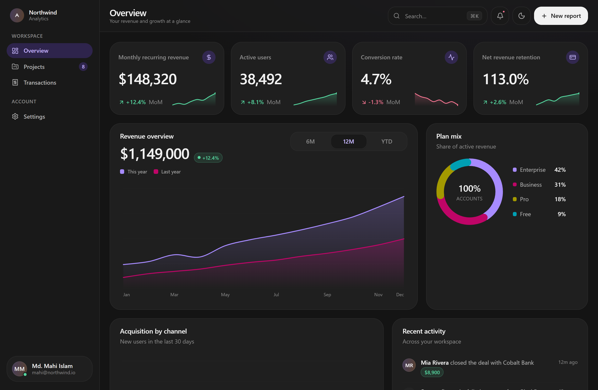

# Northwind — Arc UI Flagship Demo

A self-contained, motion-rich **SaaS analytics dashboard** built to show what an
AI agent can produce with [Arc UI](https://uiarc.dev/) — *"The React UI library
your AI agents can build with."*

It is a real-feeling product surface: a revenue overview with animated charts, a
KPI stat row with count-up numbers and sparklines, a drag-free-but-animated
kanban board, a sortable data table, a ⌘K command palette, toasts, light/dark
theming with live accent switching, and a navigation sidebar — all heavy on
motion and all respecting `prefers-reduced-motion`.



---

## What it is

Vite + React 19 + TypeScript. No chart library and no CSS framework — every
chart is hand-built with SVG + the [`motion`](https://motion.dev) package, and
every component is styled with CSS Modules on top of Arc's semantic design
tokens (`foundation.css`). Theming is pure CSS custom properties, so light/dark
and all six accent colors recolor the entire app — charts included — with zero
JS repaint.

Four components (Button, Switch, Dialog, Tabs) are built directly on Radix UI
primitives; everything else was purpose-built for this demo.

## Component inventory (`src/components/arc/`)

Built on Radix UI primitives:

- **Button** — label morph, press spring, loading state
- **Switch** — stretchy spring thumb
- **Dialog** — spring entrance, text-swap title
- **Tabs** — gliding selection highlight + directional panel transitions

Built for the flagship:

| Component | Highlights |
|---|---|
| **Card** (`card`) | Staggered rise-in entrance, interactive hover, header/title/content/footer parts |
| **Badge** (`badge`) | 13 semantic tones, dot + solid variants |
| **Avatar / AvatarGroup** (`avatar`) | Gradient initials, overlap stacks, presence status |
| **AnimatedNumber** (`number`) | Eased count-up with custom formatter, reduced-motion snap |
| **Sparkline** (`chart`) | Self-drawing SVG trend line with gradient fill + end dot |
| **AreaChart** (`chart`) | Responsive multi-series, path draw-in, hover crosshair + glass tooltip |
| **BarChart** (`chart`) | Bars spring up from baseline with stagger, hover dims + value label |
| **DonutChart** (`chart`) | Arcs sweep in via `stroke-dashoffset`, interactive legend, % center readout |
| **StatCard** (`stat-card`) | KPI tile = AnimatedNumber + delta chip + Sparkline |
| **Kanban** (`kanban`) | Cross-column **shared-layout** animation; cards glide between columns |
| **DataTable** (`table`) | Sortable headers, animated row re-order, staggered entrance |
| **CommandPalette** (`command-palette`) | ⌘K menu, substring filter, full keyboard nav, gliding highlight |
| **Toast** (`toast`) | Portal + context `useToast()`, stacked layout animation, progress bar |
| **ThemeToggle** (`theme-toggle`) | Sun/moon spin-and-scale crossfade |
| **Sidebar** (`sidebar`) | Nav with shared-layout active indicator, user footer |

## The app (`src/`)

- **Overview** — KPI row, revenue AreaChart with 6M/12M/YTD range tabs, plan-mix
  DonutChart, channel BarChart, activity feed.
- **Projects** — Kanban board (`Q4 Roadmap`); moving a card toasts and animates
  the card across columns.
- **Transactions** — summary tiles + sortable DataTable with status filtering and
  an export action.
- **Settings** — appearance (ThemeToggle + accent swatches), notification
  Switches, and a destructive action guarded by a confirmation Dialog.

Global **⌘K / Ctrl-K** opens the command palette (navigate, toggle theme, change
accent, create/export). Theme + accent persist to `localStorage` and are applied
before first paint by a tiny inline script in `index.html` (no flash).

## What makes it "extraordinary"

- **Everything moves, nothing jitters.** Entrances stagger, numbers count, charts
  draw themselves, the kanban and nav highlight use shared-layout springs, and
  panels morph height. All springs are critically damped (Arc's motion tokens).
- **One honest theming system.** Semantic tokens mean light/dark and six accents
  recolor the whole surface — including every chart series — with no per-component
  theme code.
- **Accessible motion.** Every animation has a `prefers-reduced-motion` path:
  counters snap, charts appear instead of drawing, transitions become short
  crossfades. Keyboard nav works in the palette, table, tabs, and dialogs.
- **No chart dependency.** The four chart types are ~400 lines of SVG + motion,
  matching Arc's animated aesthetic exactly.

## Run it

```bash
pnpm install     # or: npm install
pnpm dev         # http://localhost:5173
pnpm build       # type-checks (tsc -b) then builds to dist/
pnpm preview     # serve the production build
```

Node 20+ recommended (developed on Node 24 / pnpm 11). `pnpm build` passes
cleanly.

## Screenshots

Captured with headless Chrome (`screenshots/`):

- `01-overview-light.png`, `02-overview-dark.png` — dashboard, both themes
- `03-projects-dark.png` — kanban board
- `04-transactions-light.png` — sortable data table
- `05-settings-light.png` — settings with accent picker
- `06-command-palette-dark.png` — ⌘K palette

## Project layout

```
src/
  main.tsx                 # imports arc/foundation.css + index.css
  index.css                # app globals (resets, scrollbars, font tokens)
  App.tsx / App.module.css # shell, topbar, routing, ⌘K, theme state
  data.ts                  # mock SaaS data
  lib/
    utils.ts               # cn(), formatters
    use-theme.ts           # theme + accent hook (localStorage)
  pages/                   # overview, projects, transactions, settings
  components/arc/          # the Arc component library (reused + new)
```
